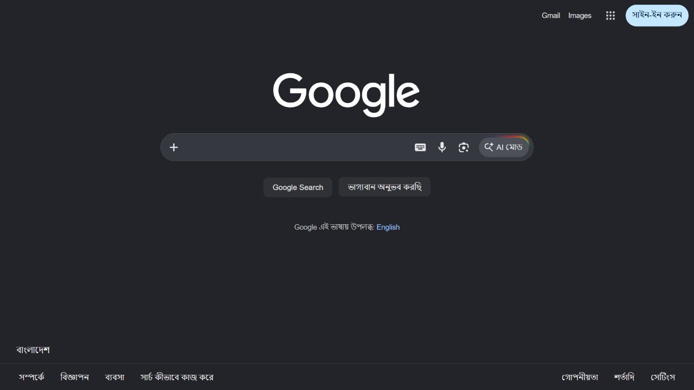
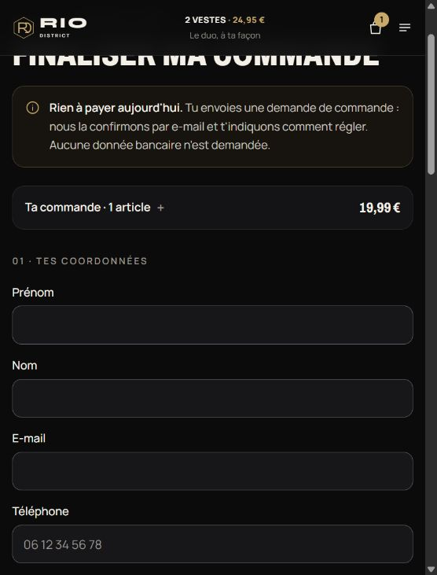

# Everflow activation readiness — 17 October 2026

**Activation blocked. Real customer traffic remains disabled.** The owner authorized the
retry fix deployment separately and authorized nontransactional external tests using
fictional customer information. No webhook/reconciliation implementation is required for
these fictional tests; this record does not claim payment confirmation.

## Canonical site and starting release

The confirmed production hostname is **https://rio-district.store**, resolving to the
authorized VPS. The starting release revision is
`6b155b959952917b84244c6d54a6f00fc72a5bc8`; its original application build was
`7a0fb5cf01ba10d8d5b9b416d6571821dc024762`.

The application and authenticated loopback MongoDB are healthy. nginx routes only this
storefront to loopback port 3000. There is approximately 16 GiB of free disk space.
The starting database has six products, 28 published reviews, one existing order,
zero payment attempts, and one existing admin/session. No customer details were printed.

## Actual external destination tests

Each supplied link was opened in the integrated browser first without prefill, then with
the exact nine encoded parameters generated from isolated fictional checkout orders.
The single order selected Green/M at EUR 19.99. The bundle selected Green/M + Black/L
at EUR 24.95. Fictional names contained accents; address data contained spaces, apostrophes,
an ampersand and an apartment suffix; email used an example.com address with a plus tag.

| Offer | Exact requested path | Observed final page, with and without prefill |
| --- | --- | --- |
| Single EUR 19.99 | `/2J23GL9/TTF23GH/` | `https://www.google.com/`, title Google |
| Bundle EUR 24.95 | `/2J23GL9/TRSKRX3/` | `https://www.google.com/`, title Google |

No payment page appeared. No product/price, shipping/contact prefill, merchant identity,
card form, or transaction confirmation could be verified. These observations apply to
this browser session; they do not establish the reason or behavior in every country.
Geo restrictions, eligibility rules, inactive offers or routing are possibilities to
confirm with the partner, not verified explanations. No geography/eligibility control
was bypassed and no unsupported parameter was invented.

Actual external results with fictional prefill:

| Field | Parameter constructed | Single external display | Bundle external display |
| --- | --- | --- | --- |
| First name | `sub10` | Unverifiable: no checkout | Unverifiable: no checkout |
| Last name | `adv3` | Unverifiable | Unverifiable |
| Email | `sub4` | Unverifiable | Unverifiable |
| Phone | `sub8` | Unverifiable | Unverifiable |
| Address + apartment | `sub7` | Unverifiable | Unverifiable |
| Postal code | `sub3` | Unverifiable | Unverifiable |
| City | `sub6` | Unverifiable | Unverifiable |
| Product label | `adv1` | Unverifiable | Unverifiable |
| Public HTTPS product image | `adv2` | Unverifiable | Unverifiable |
| Offer price | Offer-specific link | Unverifiable | Unverifiable |

Correct URL encoding and local variant preservation were verified separately in the
[production audit](EVERFLOW_PRODUCTION_AUDIT.md). They are not evidence of external prefill
acceptance. Personal query URLs were kept out of this report. Only fictional details
were transmitted during these explicitly authorized tests; no real customer data,
application credentials, card details or payment submission were involved.

## Current configuration and blockers

Both exact HTTPS offer URLs are correctly configured; TRPS2FT is not substituted.
`PAYMENT_PROVIDER=everflow`, `EVERFLOW_ENABLED=false`, mode `live`. Live/variant/bundle
approval flags are false; approved bundle image is absent. Source/click identifiers
and pixels remain unset/disabled. No environment file or secret is published here.

Before live traffic can be enabled, the partner must:

1. Provide a functioning merchant-authorized checkout/test route and explain the Google
   fallback, including any target-country, traffic or source requirements.
2. Demonstrate the two correct EUR prices, the actual accepted prefill fields and supported
   variant/fulfillment behavior; supply approved bundle label/image details.
3. Confirm permission for customer contact/shipping data transfer and the approved final
   merchant destination. The storefront disclosure exists, but provider-side permission
   has not been established by these tests.

The owner deferred webhook/payment confirmation work. Redirects, returns and a loaded page
still cannot mark orders paid or trigger fulfillment. Transaction matching remains
unverified; a future live launch must have an independently verifiable operating process.

## Retry fix deployment

The owner authorized committing, merging and deploying the verified retry fix. It
canonicalizes customer field order and preserves compatibility with older fingerprints;
changed coordinates/cart/consent/mode remain conflicts. It changes no storefront design,
product price, provider URL, safety gate or production database schema.

Local validation passed: 32 unit tests, isolated API/inventory/regression workflow,
TypeScript, ESLint and the previously rebuilt optimized Next production build. Both
mock offers and repeated-key HTTP tests passed without duplicate orders or false paid status.

The retry fix was deployed on 17 October 2026 at 16:26 Asia/Dhaka:

- Application build commit: `b703cd6ed64539e89be2bda4537842759f66e2cb`, fast-forwarded
  from `devreza/everflow-production-audit` to GitHub `main` without rewriting history.
- Release: `/srv/rio-district/releases/20261017-b703cd6`; active through the existing
  `/srv/rio-district/current` symlink. Documentation-only follow-up revisions are
  recorded separately in `REVISION`; `APPLICATION_REVISION` retains the build commit.
- The unchanged lockfile was compared with the prior release and its installed
  dependencies copied into the isolated new release; no dependency upgrade occurred.
- Linux production build passed. The loopback candidate passed seven routes and
  server price quotes of 1999 / 2495 cents before the application switch.
- The old built release was retained, then only `rio-district.service` restarted.
  Its new PID was 36309; MongoDB, nginx and SSH retained PIDs 32957, 31455 and 30498.
- All seven live routes passed after deployment; database health is `up`. No critical
  application errors were captured. Existing documents were compared by ID and full
  content and preserved: six products, settings, one order, zero payment attempts,
  28 reviews and the existing admin/session. No production test order was created.
- The private environment was byte-compared against the backup and unchanged.
  Everflow and pixels remain disabled. The live external-payment API still returns
  the intentional 409 disabled response; the actual browser shows the unpaid request
  CTA at EUR 19.99, with no external-payment CTA or captured console error.

Fresh private backup: `/var/backups/rio-district/20261017-retry-fix` includes the current
database, uploads, code, environment and recovery configuration; checksums and archive
readability passed. The existing built release is retained. Its `rollback.sh` switches
only the application symlink and restarts only `rio-district.service`; it never restores
an older database over new orders. No unrelated service or nginx site needs modification.
The full private backup was also downloaded outside the repository and its transfer
SHA256 verified. Secrets, database archives and runtime uploads were not committed.

## Readiness result

| Milestone | Result |
| --- | --- |
| Retry code deployed | Yes, application commit b703cd6 |
| Real customer redirect activated | No; readiness checks failed |
| Actual external URLs tested | Yes, both with fictional prefill; both ended at Google |
| External displayed fields and prices verified | No checkout was available to inspect |
| Local prefill encoding / offer selection / variants | Verified in isolated tests |
| Payment completed | No card entry or payment submission |
| Payment confirmed by provider | No |
| Reconciliation | Deferred by owner; not established for live fulfillment |

The next prerequisite for the requested prefill test is a working partner-approved
checkout/test destination (or confirmed access/traffic requirements). Before opening
real customer traffic, merchant authorization and permission to transfer their contact
and shipping data must be established. No safety flag is enabled merely to remove 409.
