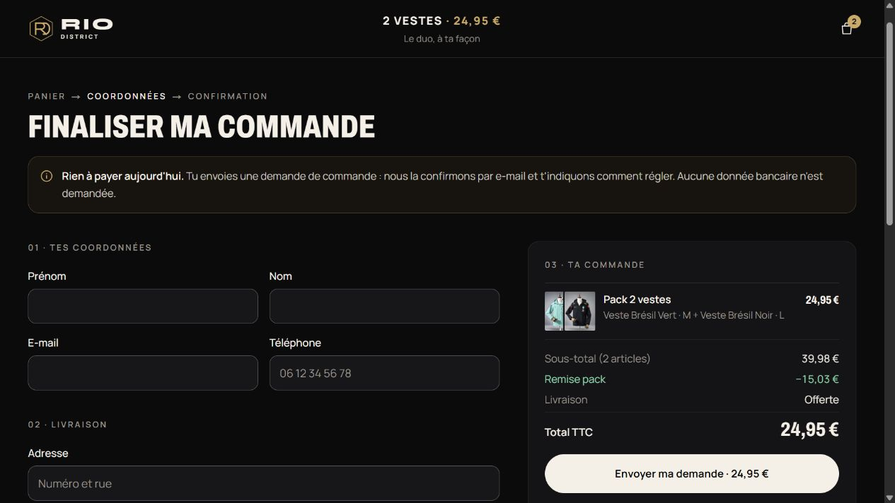
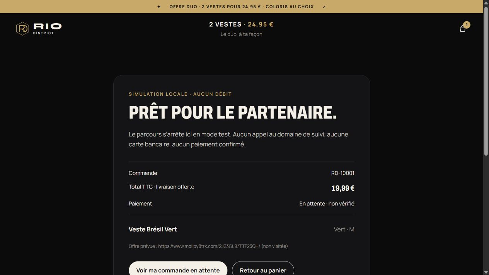
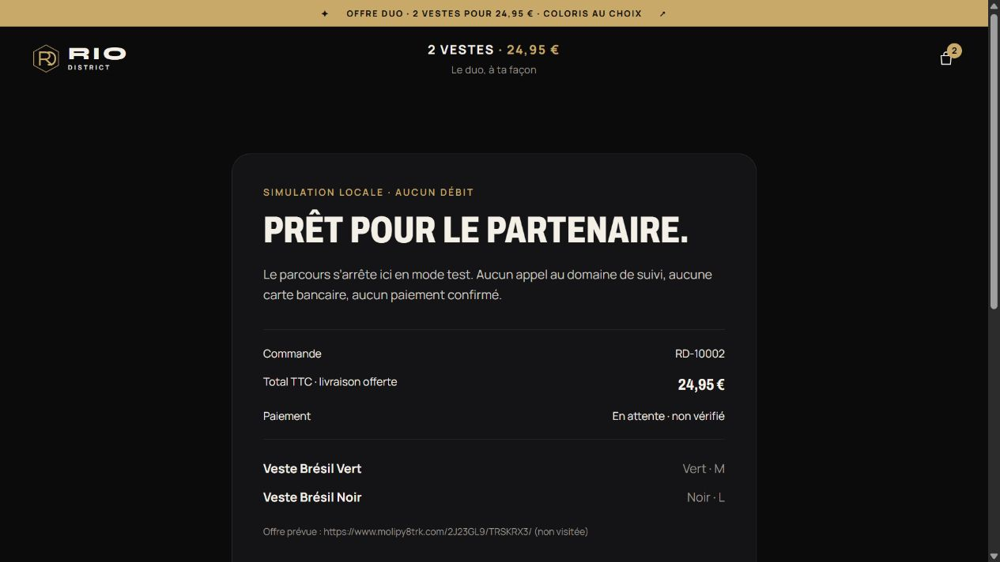

# Everflow production redirect audit

Historical audit snapshot, before the subsequent activation request. Follow-up destination
tests and the authorized retry-fix deployment are recorded in
[EVERFLOW_ACTIVATION_READINESS.md](EVERFLOW_ACTIVATION_READINESS.md).

Audit date: 17 October 2026, Asia/Dhaka. Production database snapshots were taken at
15:28 and 15:49 local time. Subsequent fix validation used isolated local data only.

**Production conclusion: INTEGRATED BUT DISABLED. Customers are not currently redirected
to Everflow. REDIRECT VERIFIED IN STAGING means the controlled local mock, not arrival at
the payment partner or successful payment.**

## A. Deployment and runtime

The requested `https://riodistrict.store` currently returns DNS NXDOMAIN. The integrated
browser also returned `ERR_NAME_NOT_RESOLVED`. The deployed canonical site is
**https://rio-district.store**, resolving to the authorized new VPS. This spelling difference
must be resolved in public links and the partner's domain approval; DNS was not changed.

| Check | Actual evidence |
| --- | --- |
| Release revision | `6b155b959952917b84244c6d54a6f00fc72a5bc8` |
| Application build source | `7a0fb5cf01ba10d8d5b9b416d6571821dc024762` |
| Version / framework / runtime | Package 0.1.0; Next.js 16.4.1; Node v22.23.3 |
| Release directory | `/srv/rio-district/releases/20261017-7a0fb5c` |
| Production build ID | `Fr0PUoYYeW99jDfzIzc9K` |
| Services | Rio District, its isolated MongoDB, and nginx active; no restarts during this audit |
| Database | Ping succeeds; authenticated loopback MongoDB on port 27018 |
| nginx | Canonical host routes to loopback port 3000; configuration validation passed |
| Application logs | No critical error events in the inspected interval |
| Integration files | All 15 inspected checkout/payment/source files present; compiled order and payment-checkout routes present |
| Source comparison | Pre-fix working files match deployed SHA256 values; Git blobs match after accounting for Windows CRLF export |
| Integration branch | `feat/everflow-checkout` is an ancestor of `main`; no missing integration commit found |

The effective configuration was inspected from the private environment plus the service
process environment. Secrets and customer documents were not printed.

| Configuration | Production value / state |
| --- | --- |
| `PAYMENT_PROVIDER` | `everflow` |
| `EVERFLOW_ENABLED` | `false` |
| `EVERFLOW_MODE` | `live` |
| `EVERFLOW_SINGLE_CHECKOUT_URL` | Exact supplied TTF23GH offer, configured |
| `EVERFLOW_BUNDLE_CHECKOUT_URL` | Exact supplied TRSKRX3 offer, configured |
| `EVERFLOW_LIVE_APPROVED` | `false` |
| `EVERFLOW_VARIANTS_APPROVED` | `false` |
| `EVERFLOW_BUNDLE_METADATA_APPROVED` | `false` |
| `EVERFLOW_BUNDLE_IMAGE_URL` | Not configured |
| `EVERFLOW_PUBLIC_ASSET_BASE_URL` | `https://rio-district.store` |
| `EVERFLOW_COUNTRIES` | `FR`; partner coverage still needs confirmation |
| `EVERFLOW_SOURCE_ID` / provider click ID | Not configured |
| `EVERFLOW_SUB1_MODE` / correlation approval | `disabled` / `false` |
| Pixel platform, IDs, Google label | Not configured |
| `EVERFLOW_PIXEL_APPROVED` | `false` |
| `RIO_EVERFLOW_TEST` | `false` |

The generic TRPS2FT example is absent from runtime configuration and rejected by the
destination validator. Enabling only `EVERFLOW_ENABLED` would still fail closed on live
approval/variant gates; live bundles additionally lack approved metadata and an image.

## B. Single jacket

| Check | Result |
| --- | --- |
| Selection | Veste Brésil Vert, M, quantity one |
| Server total | EUR 1999 cents, zero shipping |
| Intended destination | `https://www.molipy8trk.com/2J23GL9/TTF23GH/` |
| Integrated browser | Product → cart → checkout → actual POST → local mock page |
| Mock page | EUR 19.99, Vert/M, payment pending and unverified |
| Lost API response | First request committed, response deliberately lost; UI showed a network error |
| Retry | HTTP 200 duplicate response reused the same order and attempt |
| Inventory | Green/M decreased once from 50 to 49 for this order despite retries |

The pure URL builder was run against this actual saved fictional browser order and the
same mock configuration. It produced the exact single-offer origin/path. The personal
query string was inspected in memory, never visited, logged, or included in this report.

## C. Two-jacket bundle

| Check | Result |
| --- | --- |
| Selection | Green/M plus Black/L, one bundle |
| Server total | EUR 2495 cents; EUR 3998 comparison, EUR 1503 discount, zero shipping |
| Intended destination | `https://www.molipy8trk.com/2J23GL9/TRSKRX3/` |
| Integrated browser | Selected both variants, filled fictional fields, double-clicked payment CTA, reached local mock |
| Duplicate protection | Loading button disabled; one POST, one order, one attempt |
| Stored variants | Both exact products, colors and sizes preserved |
| Inventory after both browser orders | Green/M 48; Black/L 49; no duplicate reservation |

The reconstructed provider URL from the saved immutable bundle order uses TRSKRX3. Its
`adv1` label includes both selected names/colors/sizes. The mock uses the first product's
photo. Live mode requires a separately approved bundle image and metadata contract.

Local preservation is verified; provider-side variant understanding and fulfillment are
not. In particular, the supplied single-product mapping has no separate size parameter.
Single size M remains local and requires an agreed fulfillment/correlation handoff.

## D. Production browser and failure tests

The actual HTTPS checkout was opened in the integrated browser for both selections.
It shows **“Envoyer ma demande · 19,99 €”** or **“Envoyer ma demande · 24,95 €”** and
“Rien à payer aujourd'hui.” The external-payment CTA is absent, as expected for disabled
Everflow. Empty-form submission produced seven field errors and no order. The browser's
audit cart was subsequently emptied; production customer records were untouched.

An actual production POST to `/api/payments/checkout`, using a valid-format nonexistent
test token, returned **409: external payment disabled** before order lookup. An empty
POST to `/api/payments/webhook/everflow` returned **501: payment not configured**. Both
responses carried `no-store, private` and `no-referrer`. No production order was submitted.

The optimized local Next production build ran on loopback ports 3011/3012, using a unique
`rio_everflow_test_*` database, fictional fixtures, `APP_ENV=development`, and mock mode.
A local proxy forwarded only to that loopback app and injected controlled failures.
Neither it nor the app followed an Everflow offer. Test data was not copied from production.

| Scenario | Observed result |
| --- | --- |
| Missing first name / last name / address | API 422 with field-specific errors; no order |
| Invalid email / French postal code | API 422; no order |
| Unsupported quantity / amount | API 409; no order; browser EUR 49.90 cart retained with disabled payment CTA |
| Missing provider URL | Isolated real order handler returned 409 before order/stock creation |
| Generic TRPS2FT URL | Isolated handler returned 409 before creation; exact HTTPS allowlist unit tests passed |
| Disabled feature | Isolated handler returned unpaid request flow, no PaymentAttempt |
| Lost response after order commit | Helpful UI network error; retry reused order and stock |
| Unavailable destination | Controlled mock GET returned 503; browser Back and Resume recovered the same pending order |
| Double-click CTA | Loading guard blocked duplicate bundle submission |
| Browser Back after redirect | Cart retained; pending-order recovery available; no false payment success |
| Five concurrent identical submissions | Integration suite: one order, one attempt, one reservation |
| Five repeated keys through rebuilt HTTP server | Five HTTP 200 duplicates, unchanged order count and stock |
| Changed coordinates under existing key | 409 conflict, including legacy fingerprint compatibility test |
| Fake success return query | `payment=success&paid=true` did not change pending status |
| Unsigned Everflow event | Webhook 501; event application refuses Everflow; no order marked paid |

No critical JavaScript console errors were captured in the inspected live/staging tabs.
The deliberate failed response and destination 503 are controlled test failures, not
successful payments. A remote page's inability to load cannot be conclusively diagnosed
by the storefront after navigation; recovery/reconciliation remains necessary.

Actual screenshots:

Additional single-production and unsupported-cart screenshots are in the same directory.

## E. Orders, correlation and payment tracking

Orders are claimed under a unique idempotency key before tracked stock reservation.
Server pricing ignores client-supplied prices. Partial reservation failures roll back;
untracked stock is not decremented. Concurrent stock/variant tests passed. Production
order and partial unique redirect-attempt indexes were present.

Hosted orders remain `pending_confirmation` / payment `pending`. Each gets one redirect
PaymentAttempt with an opaque 192-bit reference, amount, EUR currency, offer, configuration
hash and `raw=null`. The reference is 32 base64url characters. Counts record links
**prepared**, not arrival at the provider, attempted charges or successful payments.
Retries preserve the same attempt and never reserve again. Configuration changes fail closed.

The browser retains its cart/idempotency key and an opaque pending-order token, not the
personal provider URL. Five post-fix HTTP retries left the two browser-created orders and
two attempts unchanged. No staging order became paid. The local mock never charges.

`source_id`, `sub1` and `sub5` were absent from the generated test URLs. Production has
no affiliate ID, visitor click acquisition contract or approved transmitted correlation.
The backend reference exists locally, but automated provider transaction matching is not
available. A static provider click ID would not supply genuine per-visitor attribution.

No verified webhook/postback/status API has been supplied. Everflow event application
explicitly refuses payment confirmation. Return URLs cannot mark orders paid. Authenticated
manual payment reconciliation requires an attributed explanation/reference; an operator
must verify actual transaction evidence before using it. No automatic reservation expiry
is implemented; abandoned orders and crashes during preparation need reviewed reconciliation.
Local idempotency does not guarantee provider-side charge idempotency.

## F. Prefill, security and privacy

Decoded parameters were compared with both actual saved fictional orders:

| Source value | Parameter | Result |
| --- | --- | --- |
| First name | `sub10` | Exact match |
| Last name | `adv3` | Exact match, multi-word surname retained |
| Postal code | `sub3` | Exact match |
| Email | `sub4` | Plus tag retained; schema intentionally lowercases email |
| City | `sub6` | Accented Saint-Étienne retained |
| Street + apartment | `sub7` | Spaces, apostrophes, ampersand, accents and # retained |
| Phone | `sub8` | Leading + and spaces retained |
| Product / bundle label | `adv1` | Correct product; bundle includes both variants |
| Catalog photo | `adv2` | First-party HTTPS URL; actual HEAD 200 and image content type |

`URL`/`URLSearchParams` safely encode all nine parameters. Country and notes stay local
because the client supplied no mapping. No application password, session cookie, MongoDB
URI or admin credential is included. Destination validation accepts only the exact two
approved HTTPS offer URLs, without credentials, extra ports, queries or fragments. Images
are restricted to catalog photos on the configured first-party HTTPS origin.

Checkout logs contain order number, totals, item count and status, without submitted
coordinates or full redirect URLs. Unexpected checkout errors are not serialized. Pixel
IDs are blank; no Purchase is fired by submit, pending status or return. A configured pixel
requires both approval and optional, unchecked-by-default advertising consent.

The partner-specific GET prefill would still expose customer information in browser history
and partner/proxy logs. Encoding and HTTPS do not remove that exposure. Domain authorization,
data-sharing/privacy review, retention/redaction and a POST/token alternative remain unresolved.

Everflow's [official parameter guide](https://helpdesk.everflow.io/customer/your-guide-to-parameters-macros)
describes generic tracking data and macros; it does not certify this partner's customer
prefill, payment or fulfillment semantics. Its Direct Linking limitations are an additional
partner configuration question. The supplied field meanings require partner confirmation.

Provider inspection was deliberately nontransactional: DNS resolved and a certificate-valid
TLS 1.3 handshake succeeded for `www.molipy8trk.com`. Zero offer HTTP requests were initiated
by this audit. The final checkout chain, merchant identity, displayed price, payment methods,
return behavior and charge/refund processing are **unverified** without approved test access.

## G. Confirmed bug and outstanding activation requirements

### Retry fingerprint bug — fixed locally, not deployed

The original API hashed the parsed customer object in insertion order. A client supplying
the form resolver's derived `fullName` and one letting the API derive the same name could
produce identical validated values in a different key order. Five equivalent retries against
the original optimized server returned 409, despite unchanged coordinates/cart.

The feature branch `devreza/everflow-production-audit` now uses canonical customer field
order and accepts the previous derived-name hash format. It preserves old order retries;
changed coordinates/cart/consent or checkout mode remain conflicts. No schema migration,
security gate bypass or production record edit is required.

Changed implementation: `src/lib/orders.ts`. Regression coverage:
`tests/integration/everflow.test.ts`, including explicit/derived names, legacy hashes,
unchanged reservation/attempt count and rejection of changed coordinates.

The isolated integration suite passed. The rebuilt optimized server returned five HTTP 200
duplicates for the same previously created order, with order count 2, one single attempt,
Green/M stock 48 and no paid orders. Browser pending-order recovery passed after rebuild.
Production still runs the original code and therefore retains this edge case. Deployment
requires owner approval; live payment activation is a separate decision.

Validation: 32 baseline unit tests passed; isolated API/inventory suite passed before and
after the fix; TypeScript, ESLint and the optimized post-fix build passed. No unrelated
storefront component was changed.

### Required before live activation

1. Resolve the public-domain spelling and authorize both tracking and final payment domains.
2. Confirm each exact offer's EUR amount, shipping, supported countries and variant handoff.
3. Approve bundle label/image semantics and provide the missing approved public bundle image.
4. Supply authenticated success/failure/refund evidence, transaction matching, replay handling,
   provider-side charge idempotency, expiry/reconciliation and approved return URLs.
5. Agree an echoed opaque correlation ID or another reliable matching contract; configure
   source/click IDs only if genuine and required. Never substitute customer data for a click ID.
6. Complete privacy/data-sharing/disclosure review and partner retention/redaction controls.
7. Obtain a partner-approved sandbox, validate its final merchant/price/prefill/charge behavior,
   and deploy the reviewed retry fix if approved.
8. Only after those approvals, separately authorize live flags. Pixels remain a separate,
   optional consent/attribution decision. Flipping the feature flag alone is insufficient.

## H. Readiness conclusion and production preservation

| Milestone | Verified state |
| --- | --- |
| 1. NOT INTEGRATED | False: implementation and compiled routes are deployed |
| 2. INTEGRATED BUT DISABLED | **Confirmed production state** |
| 3. REDIRECT VERIFIED IN STAGING | **Confirmed for the controlled mock**, both offers |
| 4. PRODUCTION REDIRECT VERIFIED | Not achieved; production refuses external checkout |
| 5. PAYMENT CONFIRMATION VERIFIED | Not achieved; no authenticated provider confirmation contract |

Before/after full-document hashes and counts matched for production products (6), settings
(1), orders (0), payment attempts (0), and reviews (28). No application/nginx/database service
was restarted, no flag changed, no real payment attempted, and no customer information sent
to the payment provider. The report, screenshots and retry fix are local review artifacts;
no audit fix was deployed or pushed to production/main.
